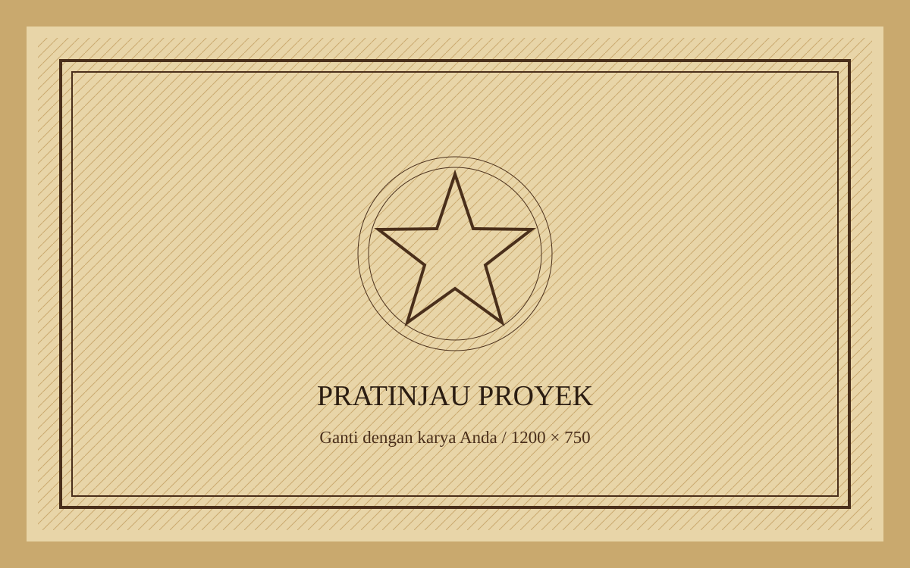

# Porto_Beta

Portofolio pribadi **Alfonsus Ronaldy Hidayat** (Sistem Informasi, Universitas Multimedia Nusantara, Jakarta), bertema perbatasan akhir 1800-an dengan nama tema **DUSTY TRAIL PORTFOLIO**. Situs statis: HTML5, CSS3, JavaScript ES modules, tanpa build step.

**Status: beta, repository saja.** Belum dipublikasikan sebagai website; GitHub Pages dimatikan dan workflow deploy hanya berjalan manual. Konten disarikan dari CV pemilik. Foto profil, gambar proyek, tautan sosial, CV unduhan, dan endpoint form belum diisi.

Untuk melihatnya, jalankan secara lokal (lihat **Menjalankan lokal**).

## Preview



Gambar di atas merupakan placeholder original, bukan screenshot situs. Jalankan server lokal untuk melihat lanskap senja, jurnal sepia, inventaris, poster interaktif, peta perjalanan, dan telegram. Identitas, pendidikan, skill dasar, pengalaman ISFEST, proyek Proxmox Home Server, dan email disarikan dari CV **Alfonsus Ronaldy Hidayat**. Foto dan pratinjau proyek masih placeholder; URL sosial, repository, serta endpoint form belum diisi. Sertifikat kosong karena tidak tercantum di CV. Nomor telepon, alamat rumah, dan PDF CV belum dipublikasikan.

## Fitur

- Intro mesin ketik dengan progres sinematik dan pintu saloon. Progres bersifat dekoratif, bukan ukuran download. Intro otomatis selesai dan dapat dilewati dengan tombol keyboard apa pun.
- Gurun SVG original: mesa berlapis, matahari, kaktus, burung, dan tumbleweed.
- Parallax scroll GSAP, gerak mouse, debu canvas, bara pada mode malam, grain, vignette, crosshair, dan efek klik.
- Jurnal foto sepia, ledger skill dengan indikator, poster yang bisa dibalik lewat mouse/keyboard/touch, stempel, serta garis rute tergambar.
- Satu tombol **Aksesibilitas** membuka panel mode gelap, kurangi gerakan, kontras tinggi, ukuran teks 100–125%, serta reset. Preferensi tersimpan lokal; reduced-motion perangkat tetap diprioritaskan. Escape, tombol Tutup, atau klik di luar menutup panel dan mengembalikan fokus.
- Form Formspree dengan validasi, timeout 15 detik, status pengiriman, dan isi tetap tersedia saat gagal.
- Audio opsional OFF secara default. Tidak ada audio bawaan atau autoplay.
- Layout responsif, skip link, fokus keyboard, alt gambar, lazy loading, serta fallback font dan CDN.
- Offset anchor mengikuti tinggi navbar agar tujuan navigasi tidak tertutup pada ponsel.
- GitHub Actions menerbitkan hanya file publik, tanpa build step.

## Struktur

```text
.
├── index.html
├── README.md
├── LICENSE
├── .gitignore
├── .nojekyll
├── check.mjs
├── assets/
│   ├── css/
│   │   ├── style.css
│   │   └── animations.css
│   ├── js/
│   │   ├── data.js
│   │   ├── main.js
│   │   ├── particles.js
│   │   └── cursor.js
│   ├── img/
│   │   ├── profile.svg
│   │   ├── project.svg
│   │   └── README.md
│   └── fonts/
│       └── .gitkeep
└── .github/
    └── workflows/
        └── deploy.yml
```

`.gitkeep` mempertahankan folder font kosong di Git; `.nojekyll` kosong memang disengaja. `check.mjs` hanya pemeriksaan pengembang, tidak diperlukan browser.

## Edit konten dari satu file

1. Buka `assets/js/data.js`.
2. Cari komentar **GANTI INI** dan token `[[...]]`.
3. Ganti nilai dummy, bukan nama properti. Contoh:

   ```js
   name: 'Nama Lengkap Anda',
   role: 'Front-end Developer',
   tagline: 'Pengalaman digital yang terasa manusiawi.',
   ```

4. Tambah/hapus objek dalam `skills`, `projects`, atau `experience`. Halaman merender jumlah item otomatis.
   `skills[].level` menerima teks seperti `'Dasar'` atau angka 0–100. Teks tidak diubah menjadi persentase; progress bar hanya muncul bila Anda mengisi angka penilaian sendiri.
5. Kosongkan `cv`, URL sosial, demo, GitHub, atau `ambientAudio` jika belum tersedia. Tombol CV/sosial/audio disembunyikan; tautan proyek diberi label belum tersedia.
6. Isi `contact.formEndpoint` dengan endpoint Formspree asli, misalnya `https://formspree.io/f/abcdefgh`. Buat form di dashboard Formspree, verifikasi email, lalu salin endpoint. Gunakan Formspree karena handler bawaan memvalidasi host dan rute tersebut.
7. Isi WhatsApp dengan nomor internasional tanpa `+`, spasi, atau tanda hubung. Contoh format: `6281234567890`.

Komentar placeholder tetap dipertahankan sebagai panduan. Teks tidak dimasukkan sebagai HTML mentah. Semua nilai JavaScript dan endpoint akan terlihat publik; jangan menaruh secret atau token privat.

### Yang perlu saya ganti

- [ ] Nama tema, nama lengkap, role, tagline, lokasi.
- [ ] Dua paragraf tentang saya, caption dan alt foto.
- [ ] Foto profil dan gambar semua proyek.
- [ ] Tinjau skill dan level sesuai CV; angka persentase opsional, bukan skor otomatis.
- [ ] Judul, deskripsi, tech stack, status, URL demo dan GitHub proyek.
- [ ] Perusahaan, jabatan, periode, deskripsi pengalaman.
- [ ] Tinjau pendidikan dan tambahkan sertifikat hanya jika ada.
- [ ] Email, WhatsApp, LinkedIn, GitHub, Instagram.
- [ ] File CV dan `cv: 'assets/cv.pdf'` setelah file tersedia.
- [ ] Endpoint Formspree dan uji kirim nyata.
- [ ] Judul, deskripsi, URL situs, dan gambar Open Graph.
- [ ] Audio ambient milik sendiri bila diperlukan.

## Ganti gambar

1. Simpan foto profil sendiri, disarankan 600 × 800, ke `assets/img/profile.webp`.
2. Simpan pratinjau proyek, disarankan 1200 × 750, misalnya `assets/img/project-1.webp`.
3. Ubah `profile.image` dan setiap `projects[].image` di `data.js`.
4. Tulis alt yang menjelaskan isi gambar, bukan nama file.
5. Sediakan JPG/PNG 1200 × 630 untuk Open Graph. SVG placeholder sering tidak didukung crawler sosial.

Semua path aset lokal relatif terhadap `index.html`, tanpa garis miring di awal. URL pihak ketiga, email, dan URL canonical merupakan pengecualian yang memang membutuhkan URL lengkap.

## Menjalankan lokal

1. Buka terminal di folder proyek.
2. Jalankan Python 3:

   ```bash
   python -m http.server 8080
   ```

3. Buka `http://localhost:8080/`. Jangan membuka `index.html` melalui `file://`: ES modules memerlukan HTTP.
4. Tekan `Ctrl+C` untuk menghentikan server.
5. Pemeriksaan file dan data opsional, dengan Node.js 18+:

   ```bash
   node check.mjs
   ```

Tidak ada `npm install`, bundler, atau build. Python/Node hanya alat lokal; bukan dependency produksi.

## Test sebelum publikasi

- Periksa lebar 360px, 768px, 1280px, dan 3840px; zoom 200%; gunakan Tab/Shift+Tab/Enter/Escape.
- Untuk screenshot halaman penuh, gulir melewati bagian proyek terlebih dahulu agar gambar lazy-load selesai dimuat.
- Balik dan kembalikan semua poster. Sisi tersembunyi memakai `inert` supaya tidak ikut urutan fokus.
- Buka Aksesibilitas; uji mode gelap, kurangi gerakan, kontras, ukuran teks, persistensi setelah refresh, dan reset. Uji Tab/Shift+Tab tetap di panel dan Escape kembali ke tombol pembuka. Aktifkan reduced-motion di OS; reset tidak boleh mengaktifkan efek berat.
- Coba form kosong, email tidak valid, endpoint kosong, jaringan gagal, lalu endpoint Formspree nyata.
- Blokir CDN GSAP: konten dan form tetap berfungsi, efek scroll tambahan dilewati.
- Nonaktifkan JavaScript: lanskap, struktur, navigasi, dan pesan fallback tetap tampil. Data pribadi dari ES module tidak dapat dirender tanpa JavaScript; form dinonaktifkan.
- Jalankan Lighthouse lewat Chrome DevTools pada deployment. Target 90+ adalah sasaran, bukan skor terverifikasi. GPU, jaringan, CDN, dan gambar pengganti memengaruhi hasil; 60fps tidak dapat dijamin di semua perangkat.

### SEO dan crawler sosial

Metadata generik tersedia di `index.html`; JavaScript menggantinya dari `data.seo`. Banyak bot Open Graph tidak menjalankan JavaScript. Untuk metadata personal tanpa menggandakan sumber konten, setelah mengedit data jalankan:

```bash
node check.mjs --sync-meta
```

Perintah ini menyelaraskan title, description, Open Graph, dan canonical ke HTML. Isi `seo.url` dengan URL publik terlebih dahulu supaya gambar Open Graph menjadi URL absolut. Ini langkah publikasi **opsional**, bukan build step wajib. Ulangi setelah perubahan SEO; data pribadi tetap diedit hanya di `data.js`.

## Git dan deploy GitHub Pages (opsional, belum dipakai)

Bagian ini hanya panduan untuk nanti. Beta ini sengaja tidak dideploy. Untuk mempublikasikan: lakukan langkah 3-4, kembalikan trigger `push` pada `.github/workflows/deploy.yml`, lalu jalankan workflow.

1. Buat repository kosong di GitHub. Repository ini bernama `Porto_Beta`. Untuk GitHub Free, gunakan repository publik.
2. Dari folder proyek jalankan:

   ```bash
   git init
   git add .
   git commit -m "Create Dusty Trail portfolio"
   git branch -M main
   git remote add origin https://github.com/SupRill/Porto_Beta.git
   git push -u origin main
   ```

3. Di repository, buka **Settings → Pages → Build and deployment**.
4. Pilih **Source: GitHub Actions**.
5. Buka tab **Actions**, pilih workflow **Deploy static portfolio to GitHub Pages**, lalu **Run workflow** pada branch `main`. Bila push awal gagal sebelum Pages diaktifkan, jalankan ulang setelah langkah 4.
6. Tunggu workflow berhasil. URL tersedia pada environment `github-pages` dan halaman Settings → Pages.
7. Setelah berhasil, situs tersedia di `https://suprill.github.io/Porto_Beta/`.
8. Setiap push berikutnya ke `main` otomatis memperbarui situs.

Workflow hanya menyalin `index.html`, `assets/`, `.nojekyll`, dan `LICENSE` ke artifact publik. Tidak memerlukan token rahasia tambahan; izin Pages memakai token bawaan GitHub.

## Warna, font, kecepatan

- **Warna:** edit token `:root` di `assets/css/style.css`. Override mode malam di `:root[data-theme="night"]`.
- **Font:** edit `--font-display`, `--font-heading`, `--font-body`, `--font-label`, serta URL stylesheet/preload Google Fonts di `index.html`. Gunakan font OFL dari Google Fonts.
- **Kecepatan GSAP/intro:** edit `motion.duration`, `motion.intro` di `data.js`, satuan detik.
- **Jumlah debu:** edit `motion.particles`; dibatasi 60, maksimal 20 pada ponsel.
- **Loop CSS:** edit durasi di `animations.css`: matahari 35s, burung 30s, tumbleweed 23s. Lebih besar berarti lebih lambat.
- **Efek hover/flip:** durasi berada pada selector terkait di `style.css`.

## Credit dan lisensi

- Kode, CSS, SVG, placeholder, serta gambar dekoratif original proyek: [MIT](LICENSE).
- [Rye](https://fonts.google.com/specimen/Rye), [IM Fell English SC](https://fonts.google.com/specimen/IM+Fell+English+SC), [IM Fell English](https://fonts.google.com/specimen/IM+Fell+English), [Special Elite](https://fonts.google.com/specimen/Special+Elite): Google Fonts, SIL Open Font License. Jika self-host, salin berkas OFL font bersama file font.
- [GSAP 3.12.5 dan ScrollTrigger 3.12.5](https://gsap.com/): dimuat melalui jsDelivr; library memiliki [lisensi tersendiri](https://gsap.com/community/standard-license/), tidak dilisensikan ulang sebagai MIT oleh proyek ini.
- [Formspree](https://formspree.io/): layanan pihak ketiga opsional untuk penerimaan form; kuota mengikuti akun pemilik.
- Tidak ada foto eksternal, musik, sound effect, screenshot, atau logo franchise yang disertakan.

Proyek ini **fan-inspired oleh estetika western sinematik secara umum**, bukan adaptasi aset tertentu, dan **tidak berafiliasi, disponsori, atau didukung pihak mana pun**. Hak cipta karya original tetap ada dan diberikan melalui MIT; font/library mengikuti lisensi masing-masing. Gunakan hanya foto, CV, dan audio yang Anda miliki atau punya izin penggunaan.
